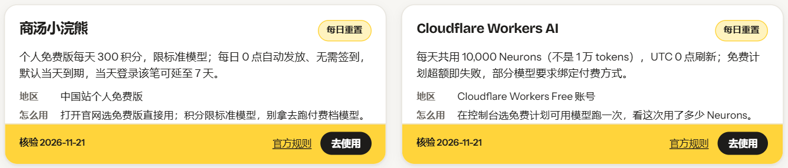

[](https://ymtuan.live/free-ai)

# 免费 AI 额度，今天还有哪些能用？

想给小工具接个模型，或者只是偶尔用 AI 处理文档？**先看看你已经能免费用多少，再决定要不要开会员。**

**[去挑免费 AI →](https://ymtuan.live/free-ai)**　·　[在 GitHub 直接看清单](skills/yangmao-public/references/catalog-zh.md)　·　[装进我的 AI 助手](#安装与使用)　·　[English](#english)

### 今天想省哪一笔？

**每天都能用的。** [商汤小浣熊](https://ymtuan.live/free-ai#raccoon-daily)的个人免费版每天给 **300 积分**，不用签到，可以拿来处理文档。当天登录，那天的积分还能延长到 7 天使用。

**写代码能用的。** [Cloudflare Workers AI](https://ymtuan.live/free-ai#workers-ai-daily)每天送 **10,000 Neurons**，北京时间早上 8 点刷新。想周末做个小应用，可以先挑免费计划支持的模型跑起来。

**看上去很香、但得先花钱的。** [七牛的新人 300 万 Token](https://ymtuan.live/free-ai#qiniu-newuser-pack)要在首次调用产生费用后才发。如果你的预算就是零，这一条可以直接跳过。

上面三条核于 2026 年 11 月 21 日。**[打开今日目录](https://ymtuan.live/free-ai)**，按「每日额度」「新人一次」「限时活动」挑；每项都能点回厂商原始规则。点右上角 **Star** 收藏，下次缺额度时从这里找。

[](https://ymtuan.live/free-ai?cycle=daily)

## 安装与使用

如果你常用支持 Skills 的 AI 助手，把下面这句话复制给它：

```text
请从 https://github.com/PigeonAI-Yang/yangmao-skill 安装 skills/yangmao-public 目录里的 yangmao-public。装好后帮我找：中国大陆能用、免费额度用完会停的模型 API，给我官方入口。
```

以后直接问：**「我是老用户，新人礼包都跳过。哪些编程额度每天会恢复？」** 助手会按你的条件查目录，带上来源和核验日期。不用交 API 密钥，也不用把账号给它。

喜欢手动安装？把 [yangmao-public 文件夹](skills/yangmao-public/)整个放进你的 Skills 目录即可。

### English

[Browse free AI offers](https://ymtuan.live/en/free-ai) or [read the English list on GitHub](skills/yangmao-public/references/catalog-en.md). To install, ask your agent:

```text
Install the yangmao-public skill from skills/yangmao-public in https://github.com/PigeonAI-Yang/yangmao-skill. Find a free model API I can use in my region that stops when my allowance runs out.
```

<a href="https://ymtuan.live"><picture>
  <source media="(prefers-color-scheme: dark)" srcset="assets/brand/lockup-horizontal-dark.png">
  
</picture></a>

## 羊毛团开源项目

[项目总览与源码入口](https://github.com/PigeonAI-Yang/yangmao-skill/blob/main/OPEN-SOURCE.md) · [羊毛团官网](https://ymtuan.live/)

- 内容工具与 Skills：**免费 AI 额度 Skill** · [X 长文写作 Skill](https://github.com/PigeonAI-Yang/x-article-creator) · [发布助手](https://github.com/PigeonAI-Yang/yangmao-publisher)
- Magpie 插件：[Codex 图片瘦身](https://github.com/PigeonAI-Yang/yangmao-magpie-image-slim) · [Devin 图片缓存](https://github.com/PigeonAI-Yang/yangmao-magpie-devin-image-history)
